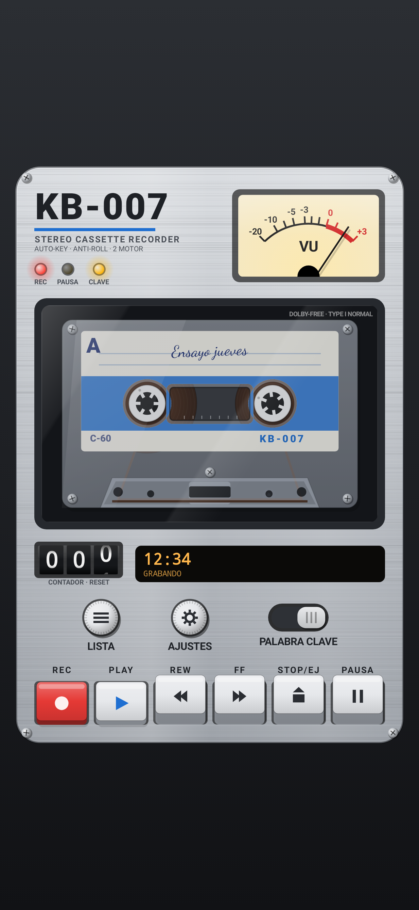
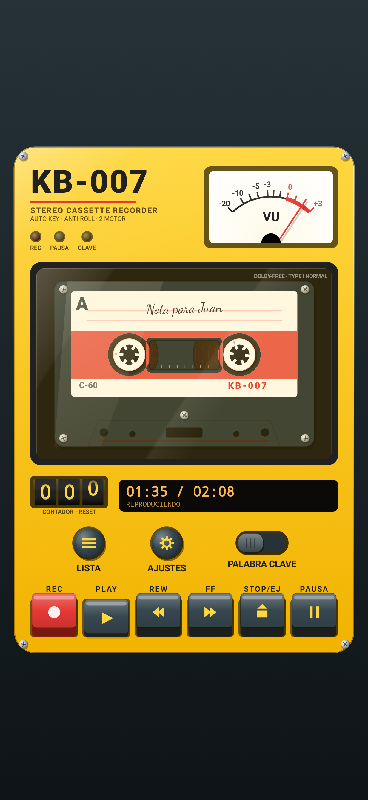
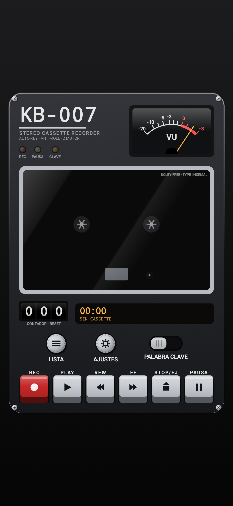
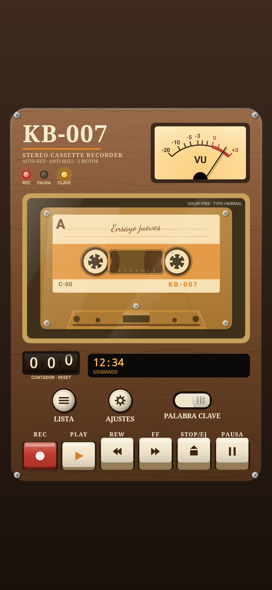
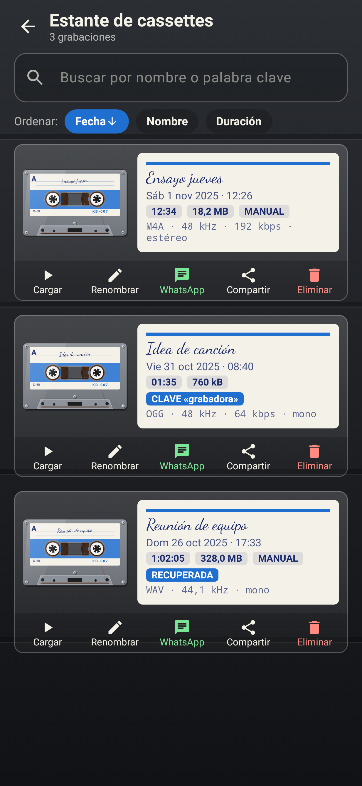
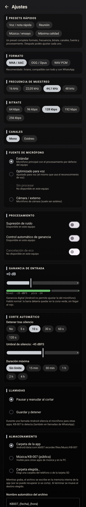

# KB-007 — Grabadora de cassette para Android

Grabadora de audio con estética de walkman de los 80. Graba a mano con la tecla **REC** o sola, al
escuchar una **palabra clave** que elegís vos, incluso con la pantalla apagada. El reconocimiento es
100 % offline: no se envía nada a internet.

| Metálico 80 | Retro deportivo | Negro periodista | Madera 70 |
|---|---|---|---|
|  |  |  |  |

| Estante de cassettes | Ajustes |
|---|---|
|  |  |

---

## 1. Instalar el APK en el teléfono

El APK debug queda en `app/build/outputs/apk/debug/app-debug.apk` (unos 79 MB, porque incluye el
modelo de voz).

**Opción A: sin cables**
1. Pasá el archivo `app-debug.apk` al teléfono (por Drive, Telegram, cable USB o como te quede cómodo).
2. Abrilo desde la app **Archivos** o desde la notificación de descarga.
3. Android te va a pedir permiso para **instalar apps desconocidas** desde esa app (Archivos, Chrome,
   etc.). Activalo y volvé atrás.
4. Si aparece **Play Protect** («App no reconocida»), tocá *Más detalles* → *Instalar de todas formas*.
   Pasa porque el APK está firmado con una clave de desarrollo y no viene de Play Store.

**Opción B: con `adb`**
```bash
adb install -r app/build/outputs/apk/debug/app-debug.apk
```

Para actualizar, instalá el APK nuevo encima: las grabaciones se conservan. El proyecto trae su
propia clave debug (`keystore/debug.keystore`), así que cualquier APK compilado desde este repo,
en cualquier PC, se instala sobre el anterior.

> Requisitos: Android 8.0 o superior (API 26) y un teléfono ARM (prácticamente todos los reales).
> El APK no incluye librerías para emuladores x86 (ver *Limitaciones*).

---

## 2. Compilar

Requisitos: **JDK 17+** y **Android SDK** con *platform 35* y *build-tools 35* (Android Studio
Ladybug o posterior ya los trae).

```bash
git clone https://github.com/castrolabia-code/kb007.git
cd kb007
./tools/fetch_model.sh          # descarga el modelo Vosk en español (~39 MB) a app/src/main/assets/model-es
./gradlew assembleDebug         # genera app/build/outputs/apk/debug/app-debug.apk
```

Si no tenés `ANDROID_HOME` configurado, creá `local.properties` con `sdk.dir=/ruta/al/Android/Sdk`.

Tests:
```bash
./gradlew testDebugUnitTest             # lógica de audio, contenedores, matcher de palabra clave
./gradlew recordRoborazziDebug          # regenera las capturas de pantalla (docs/capturas)
```

### Modelo de voz Vosk
- Modelo: **`vosk-model-small-es-0.42`** (Apache 2.0, de [alphacephei.com/vosk/models](https://alphacephei.com/vosk/models)).
- `tools/fetch_model.sh` lo descarga y lo deja en `app/src/main/assets/model-es/`. Está en
  `.gitignore` por su tamaño.
- Para hacerlo a mano: descargá el zip, descomprimilo y renombrá la carpeta a
  `app/src/main/assets/model-es` (adentro tienen que quedar `am/`, `conf/`, `graph/` e `ivector/`).
- Si compilás sin el modelo, la app funciona igual, pero la palabra clave avisa que falta el modelo.
- La primera vez que se activa la escucha, el modelo se copia del APK a la memoria interna
  (~58 MB, tarda unos segundos). Las siguientes veces carga en 1 o 2 s.

---

## 3. Cómo se usa

| Tecla | Qué hace |
|---|---|
| **REC** | Empieza a grabar. Como en un aparato real, quedan hundidas REC + PLAY. |
| **PLAY** | Reproduce el cassette cargado. Si la cinta está al final, primero rebobina. Si no hay cassette, carga la última grabación. |
| **REW / FF** | Bobinado rápido (sin audio). Se destraban con PLAY o STOP. |
| **STOP/EJ** | Detiene. Un segundo STOP **expulsa** el cassette. |
| **PAUSA** | Pausa la grabación o la reproducción (queda trabada). |

- **Contador**: tocalo para ponerlo en 000.
- **LISTA**: estante de cassettes. Tocar una grabación la *carga* en el aparato.
- **AJUSTES**: calidad, procesamiento, palabra clave, almacenamiento y tema.
- **Switch PALABRA CLAVE**: activa o desactiva la escucha. LED ámbar fijo = escuchando; parpadeando = cargando el modelo.

La grabación manual también corre en el servicio en primer plano: podés salir de la app o apagar la
pantalla y sigue grabando. La notificación muestra un cronómetro y los botones Detener y Pausa.

---

## 4. Cómo funciona el modo palabra clave

```
           ┌──────────── RecorderService (Foreground Service tipo "microphone") ────────────┐
AudioRecord│ MicCapture: UN SOLO stream (formato elegido) + ganancia digital                 │
           │   ├─► VU / LED / detector de silencio                                           │
           │   ├─► Buffer circular de pre-grabación (2–5 s)  ─┐                              │
           │   ├─► Mezcla a mono + remuestreo a 16 kHz ─► compuerta de energía ─► Vosk        │
           │   └─► Codificador (AAC/Opus/WAV) ◄──────────────┘ al detectar: pre-roll + vivo  │
           └────────────────────────────────────────────────────────────────────────────────┘
```

1. Activás el switch **PALABRA CLAVE** **con la app abierta**. Android 14/15 solo permite iniciar el
   micrófono en segundo plano si el servicio arrancó con la app visible. A partir de ahí podés apagar
   la pantalla o salir.
2. El servicio mantiene un **wake lock parcial** (la CPU sigue andando con la pantalla apagada) y una
   notificación fija con estado y botones *Grabar ya* y *Detener escucha*.
3. Un **único `AudioRecord`** alimenta al detector y al grabador, así no hay dos lectores
   compitiendo por el micrófono.
4. Para ahorrar batería, Vosk solo procesa audio cuando hay sonido por encima del ruido de fondo
   (piso de ruido adaptativo). Incluye ~300 ms previos para no cortar el comienzo de la palabra y
   ~1,2 s posteriores para cerrar la frase.
5. Vosk usa una **gramática restringida**: solo tu frase, la palabra de detención y `[unk]` (todo lo
   demás). Una frase se acepta si la confianza promedio de sus palabras supera el umbral del slider.
   Los resultados parciales exigen +15 puntos de confianza, para reaccionar antes sin disparos falsos.
6. Al detectar la frase: vibración y/o beep corto (configurables), empieza la grabación con la calidad
   elegida **incluyendo los segundos previos** (pre-grabación) y queda marcada como *por palabra clave*.
7. La grabación termina con STOP, con la palabra de detención (si configuraste una), tras N segundos
   de silencio o por duración máxima.

En **Ajustes → Palabra clave** el campo valida tu frase contra el vocabulario del modelo
(`vosk_model_find_word`). Si una palabra no existe en el modelo, no se puede detectar y te avisa.
**Probar palabra clave** muestra en vivo lo que oye el reconocedor y la confianza, sin grabar.

**Elegir buena palabra clave**: 2 o 3 palabras poco comunes en una conversación («atención
grabadora», «grabadora empezá»). Una palabra corta o muy frecuente («listo», «bueno») da falsos
positivos.

Para probar frases y umbrales en la PC: `tools/kw_sim.py` replica la misma lógica en Python
(`pip install vosk numpy`).

### Consumo de batería esperado (estimación)
| Situación | Consumo aproximado |
|---|---|
| Escucha en ambiente silencioso (la compuerta deja pasar poco audio) | 2–4 % por hora |
| Escucha con conversación constante alrededor | 5–8 % por hora |
| Grabando (AAC, pantalla apagada) | 3–5 % por hora |
| Grabando con la app abierta (animaciones a 60 fps) | 8–15 % por hora |

Son valores típicos de un teléfono de gama media. Varían mucho según el procesador. No pude medirlos
en un equipo real: confirmalos con la prueba 6 de [PRUEBAS.md](PRUEBAS.md).

### Limitaciones por fabricante
Algunos fabricantes cortan apps en segundo plano aunque tengan un servicio en primer plano. Si la
escucha se detiene sola con la pantalla apagada:

- **Xiaomi / Redmi / POCO (MIUI / HyperOS)**: Ajustes → Apps → KB-007 → *Ahorro de batería* →
  **Sin restricciones**, y activá **Inicio automático**. En «Recientes», mantené presionada la app
  y tocá el **candado**.
- **Samsung (One UI)**: Ajustes → Batería → Límites de uso en segundo plano → agregá KB-007 a
  **Apps que nunca entran en suspensión**. Ajustes → Apps → KB-007 → Batería → **Sin restricciones**.
- **Huawei / Honor**: Ajustes → Batería → Inicio de apps → KB-007 → **gestión manual** con las tres
  opciones activadas.
- **OnePlus / OPPO / realme**: Ajustes → Batería → KB-007 → **Permitir actividad en segundo plano**.
  Desactivá también la «optimización inteligente».
- **Google Pixel / Motorola / Nokia**: con la exclusión de optimización que pide la app alcanza.

Más detalles por modelo: [dontkillmyapp.com](https://dontkillmyapp.com).

---

## 5. Formatos y calidad
| Formato | Notas |
|---|---|
| **M4A / AAC-LC** (por defecto) | Compatible con todo y con WhatsApp. Durante la grabación se escribe como ADTS (resiste cortes) y al terminar se reempaqueta a MP4 sin recodificar. |
| **OGG / Opus** | El más eficiente para voz. Requiere Android 10+. Opus solo acepta 8/12/16/24/48 kHz: con 22,05 o 44,1 kHz se graba a 48 kHz. Contenedor Ogg propio, página por página. |
| **WAV PCM 16 bits** | Sin compresión (~5 MB por minuto a 44,1 kHz mono). La cabecera se actualiza cada segundo. |

Al compartir un WAV, la app ofrece **convertirlo a M4A** (unas 10 veces más liviano) o enviarlo igual.

**Presets**: *Voz / nota rápida* (AAC 22 kHz 64 kbps mono), *Reunión* (AAC 44,1 kHz 96 kbps),
*Música / ensayo* (AAC 48 kHz 192 kbps estéreo sin procesar), *Máxima calidad* (WAV 48 kHz estéreo).

---

## 6. Robustez
- **Cierre inesperado** (crash, batería agotada, «forzar detención»): al abrir la app, las grabaciones
  que quedaron a medias se reparan, se guardan y aparecen marcadas como **RECUPERADA**. Como máximo se
  pierde el último segundo.
- **Llamadas** (incluidas las de WhatsApp): se detectan por el modo de audio del sistema. Según el
  ajuste, la grabación se **pausa y se reanuda** al cortar, o se **guarda y se detiene**. La escucha de
  la palabra clave se suspende durante la llamada.
- **Otra app toma el micrófono**: Android 10+ avisa que nuestro micrófono quedó silenciado. La
  grabación se pausa y se reanuda cuando lo liberan. Si el micrófono está ocupado al empezar, aparece
  un aviso.
- **Foco de audio**: una grabación manual pide foco transitorio (pausa la música de otras apps). Si un
  asistente de voz lo toma, la grabación se pausa. La reproducción se pausa sola ante llamadas o al
  desconectar auriculares.
- **Espacio insuficiente**: no empieza a grabar con menos de 30 MB libres. Si se llega a ese límite
  durante la grabación, la guarda y se detiene.

---

## 7. Limitaciones conocidas
1. **Ganancia del micrófono**: Android no expone la ganancia analógica. La ganancia es **digital**
   (antes de codificar, con limitador suave para no saturar).
2. **Reanudar la escucha tras reiniciar**: Android 14/15 prohíbe abrir el micrófono desde el arranque
   del sistema. En su lugar aparece una notificación «Tocá para reanudar la escucha»; con un toque
   vuelve a escuchar.
3. **WhatsApp**: el botón abre WhatsApp con el audio adjunto, pero Android no permite elegir el
   contacto por vos. Los M4A llegan como archivo de audio. Para el estilo «nota de voz», usá OGG/Opus.
4. **Opus** necesita Android 10+. En Android 8/9 la opción aparece deshabilitada.
5. **Estéreo, «sin procesar», supresión de ruido, AGC y cancelación de eco** dependen del teléfono.
   La app detecta qué hay y deshabilita lo demás.
6. **Precisión de la palabra clave**: el modelo pequeño de Vosk funciona bien con frases claras a 1–3 m.
   Con ruido fuerte (música alta, viento) o mucha distancia baja la detección. Ajustá la sensibilidad
   con «Probar palabra clave».
7. **El beep de aviso** (si está activo) suena bajo y puede quedar al comienzo del archivo. Los clics
   de las teclas durante una grabación también se graban, como en un walkman real. El **zumbido del
   motor no suena mientras graba**.
8. **Emuladores x86**: el APK solo incluye librerías ARM para que pese menos. Para probar en un
   emulador, quitá `abiFilters` en `app/build.gradle.kts`.
9. **Música/KB-007 pública** en Android 8/9 requiere el permiso de almacenamiento. Si no está, se
   guarda en la carpeta de la app.
10. No pude probar la app en un teléfono físico durante el desarrollo. Se verificó con:
    - tests automáticos de la lógica de audio y contenedores;
    - validación con ffmpeg de los archivos Ogg/Opus y WAV generados;
    - capturas de la interfaz en varios tamaños;
    - una simulación del detector con voz sintética.

    Lo que depende del hardware (micrófono, pantalla apagada, WhatsApp) hay que probarlo con
    [PRUEBAS.md](PRUEBAS.md).

---

## 8. Arquitectura

Kotlin + Jetpack Compose, MVVM, corrutinas/Flow, Room (metadatos), DataStore (ajustes), Media3
(reproducción), Vosk + JNA (palabra clave). Inyección de dependencias manual (`di/AppContainer.kt`).

```
app/src/main/java/com/kb007/recorder/
├─ KbApp.kt, MainActivity.kt, di/AppContainer.kt
├─ audio/
│  ├─ capture/   MicCapture (único AudioRecord + efectos), DeviceCapabilities
│  ├─ dsp/       RingBuffer, MonoResampler, LevelMeter, SoftGain, SilenceDetector
│  ├─ encode/    AacAdtsEncoder, Remuxer (ADTS→M4A), OpusOggEncoder, OggWriter, WavWriter, Transcoder
│  ├─ engine/    RecorderEngine (máquina de estados), RecoveryManager
│  └─ playback/  PlayerController (Media3 + REW/FF + Visualizer para el VU)
├─ wakeword/     VoskModelManager, VoskKeywordDetector, KeywordMatcher
├─ service/      RecorderService (FGS micrófono), KbNotification, BootReceiver
├─ data/         Room (Recording), DataStore (AppSettings), RecordingsRepository, StorageManager
├─ share/        ShareHelper (FileProvider, WhatsApp, conversión)
└─ ui/
   ├─ theme/     KbTheme + KbThemes (registro), Materials (texturas)
   ├─ deck/      DeckScreen, Cassette, Instruments (VU, contador, LED), Keys, DeckViewModel
   ├─ library/   estante de cassettes
   ├─ settings/  ajustes + sección palabra clave
   ├─ permissions/ explicación previa a cada permiso
   └─ fx/        DeckFx (sonidos sintetizados + vibración)
```

### Agregar un tema nuevo
En `ui/theme/KbThemes.kt`, creá un `val miTema = KbTheme(id = "mi_tema", …)` con colores, material
(`BRUSHED_METAL`, `GLOSSY_PLASTIC`, `WOOD`, `MATTE_BLACK`) y tipografías, y sumalo a `all`. Aparece
solo en Ajustes; ningún otro archivo necesita cambios.

## Licencias
- Código: uso personal.
- Modelo Vosk español: Apache 2.0 (Alpha Cephei).
- Sonidos: sintetizados por la app. Gráficos: dibujados con Compose Canvas. No usa marcas ni
  logos de terceros.
